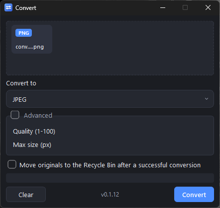

<p align="center"></p>

# Convert for Windows

[](https://github.com/TheCreator0169/convert/actions/workflows/tests.yml)

Right-click files in Explorer, choose **Convert**, pick a format. Everything runs on your PC: your files are never uploaded,
no account, no analytics. Once a day Convert asks GitHub whether a newer version exists (the only network call; turn it off with `"update_check": false` in `%APPDATA%\Convert\settings.json`).

<p align="center"></p>

The result goes **next to the original** and nothing is overwritten. Convert many files at once, or drag them onto the window.

| Input type | Output formats |
|---|---|
| 🎵 Audio | MP3, M4A, WAV, AIFF, FLAC, ALAC, Opus, OGG, WMA, AC3, WavPack, MP2 |
| 🎬 Video | MP4 (H.264, HEVC, AV1), MOV, WebM, MKV, GIF, or any audio format |
| 🖼️ Images | JPEG, PNG, HEIC, AVIF, WebP, TIFF, GIF, BMP, PDF |
| 📄 Documents | PDF, DOCX, ODT, RTF, TXT, HTML (from TXT, MD, HTML, RTF, DOC, DOCX, ODT) |
| 📕 PDF | PNG or JPEG (one per page), TXT |

A HEIC with several images, converted to a single-image format, gives one file per image (`name_1.jpg`, `name_2.jpg`, ...).

## Install

1. Download `Convert-Setup-vX.Y.Z.exe` from the [latest release](https://github.com/TheCreator0169/convert/releases/latest).
2. Run it (no admin rights needed, except for the optional Windows 11 menu step below).
3. Right-click any file and choose **Convert**.

- Windows warns "protected your PC"? Click **More info**, then **Run anyway**. The installer is not signed.
- Windows 11: the setup offers **Show Convert in the Windows 11 right-click menu** (ticked by default). It registers a small signed package and adds a certificate to the Trusted People store, which needs **one administrator (UAC) prompt**, so **Convert** appears in the short menu. Decline the prompt and the classic entry still works. Untick it and the entry stays under **Show more options** (or Shift+F10). What is trusted and how to remove it: [SECURITY.md](SECURITY.md).
- Audio and video need ffmpeg: `winget install Gyan.FFmpeg`. Everything else works without it.

Untested on other machines: keep your originals until you trust it.

## Window

Theme: right-click the version label at the bottom of the window and choose System, Dark or Light. With the keyboard, Tab to the label and press the Menu key.

## Uninstall

Windows Settings, Apps, Convert. It removes the program, the menu entries, the Windows 11 package and its certificate (one more administrator prompt), and asks whether to keep your settings.

## Security

Everything runs locally; the only network call is the optional daily update check. The installer is not code-signed. It needs no admin rights, except for the optional Windows 11 menu step, which asks once to add one self-signed certificate (`CN=TheCreator0169`) to the machine's Trusted People store; its private key is deleted when the release is built. Full list of what is installed, trusted and removed, and how to report a problem: [SECURITY.md](SECURITY.md).

## Known limits

- Legacy `.doc` (Word 97-2003) inputs keep the text only: no formatting, pictures, headers, footnotes or text boxes (headers, footnotes and text boxes are not read at all); tables become tab-separated lines, and an empty cell in the middle of a row is lost. Password-protected files are refused. A `.doc` name on HTML, WordML or plain text is refused ("not a Word document"); RTF, DOCX and ODT content under a `.doc` name is read as that format. Only files made by Word 365 were tested. ODT keeps headings, lists, tables, links and PNG, JPEG, GIF and BMP pictures; text frames and drawings are not read. RTF keeps paragraphs, bold and italic, links and tables; headings, lists and pictures are not read. Either one gives a warning and the original is kept.
- An animated GIF keeps every frame only for PDF, TIFF, GIF and WebP outputs.

Details: `docs\known-issues.md`.

## Develop

```
py -3.13 -m venv .venv-win
.venv-win\Scripts\python.exe -m pip install -r requirements.txt
.venv-win\Scripts\python.exe -m unittest discover -s tests -t .
```

Run the window with `.venv-win\Scripts\python.exe convert.pyw`; build with `powershell -File build.ps1 vX.Y.Z`.

## License

MIT, see `LICENSE`. ffmpeg is not bundled and keeps its own license.
Inspired by the macOS app [Convert](https://github.com/newtonstudios/convert) by newtonstudios; written from scratch.

## Support

If Convert is useful to you, you can buy me a coffee.

<a href="https://www.buymeacoffee.com/TheCreator0169"></a>
